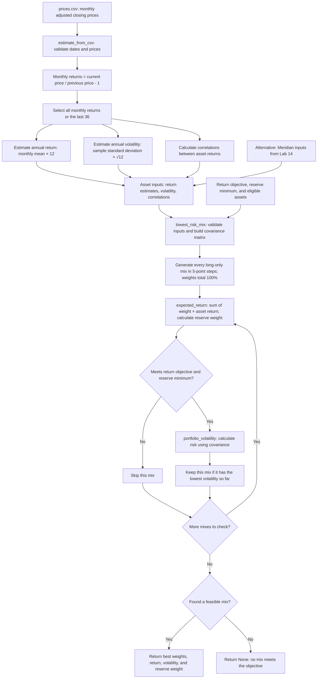

# Lab 15 — Portfolio Stability Decision

Date: October 22, 2026. Built with AI assistance; personal and partner exercises remain for the student.

Assignment: [Lab 15](https://github.com/CinderZhang/FIN43900-Fall2026/blob/main/lessons/week-09/lab-15-portfolio-stability.md).

## D — Decision question

Which mix carries the least risk while meeting the mandate — and does the answer survive a one-point change in one estimate?

The app searches for the lowest annualized volatility among long-only allocations on a 5-percentage-point grid. This is a grid minimum under the selected estimates and two checks, rather than proof of full mandate compliance or future performance.

- [ ] Explain your universe, objective, and hard constraint to your partner without a screen; swap.
- [ ] Draw the engine on paper without AI and show your partner before comparing it with the generated diagram below.

## R — Inputs and mandate

Meridian starts with the unchanged Lab 14 inputs, a 6.5% return objective, and a 3% reserve minimum. Treasury bills and the 10-year Treasury note are eligible in that training case. These are course-authored values, not market observations.

The working ETF research universe from this conversation is:

| Ticker | Fund | Role | Price source | Download date (UTC) |
|---|---|---|---|---|
| SGOV | iShares 0–3 Month Treasury Bond ETF | Short-term Treasury reserves | [Yahoo Finance](https://finance.yahoo.com/quote/SGOV/history/) | 2026-10-22 |
| IEF | iShares 7–10 Year Treasury Bond ETF | Intermediate Treasury exposure | [Yahoo Finance](https://finance.yahoo.com/quote/IEF/history/) | 2026-10-22 |
| LQD | iShares iBoxx $ Investment Grade Corporate Bond ETF | Corporate credit exposure | [Yahoo Finance](https://finance.yahoo.com/quote/LQD/history/) | 2026-10-22 |
| VTI | Vanguard Total Stock Market ETF | U.S. equities | [Yahoo Finance](https://finance.yahoo.com/quote/VTI/history/) | 2026-10-22 |
| VXUS | Vanguard Total International Stock ETF | International equities | [Yahoo Finance](https://finance.yahoo.com/quote/VXUS/history/) | 2026-10-22 |

`prices.csv` contains 61 observations from **2021-09-30 through 2026-09-30**, giving 60 monthly returns. It was obtained free, without an account, paid subscription, or API key. October 2026 is incomplete and is excluded. These are adjusted historical prices, not live quotes or the original unadjusted closing prices. Adjustment includes payouts and splits as supplied by Yahoo.

The downloader obtains daily adjusted closes and takes the final trading-day observation in each completed month. All five funds have the same observation dates. No missing prices were filled, invented, or replaced with unadjusted closes. The downloaded values are retained at source precision. Yahoo can revise adjusted histories after later distributions; each download is a dated snapshot.

See [sources.json](sources.json) for exact request URLs, UTC retrieval timestamps, and each sampled observation. Original Yahoo responses are saved in [sources/](sources/). The source field is `indicators.adjclose[0].adjclose`. Data is checked for complete consecutive months, matching dates, and finite positive prices; it has not been independently reconciled against a second vendor.

Your Lab 13 draft specifies a 7.5% net annualized return objective and a 10% short-duration Treasury buffer. To explore that draft, set the app to 7.5% and 10%, and mark only SGOV reserve-eligible, assuming Treasury ETFs are permitted. The app uses arithmetic annualized historical return estimates; it does not directly test five-year compounded net performance. Do not subtract the ETF expense ratio again from the adjusted-price return: fund expenses already affect fund values. Investor taxes, trading costs, and advisory fees are not modeled.

The draft's 7% single-issuer rule needs a definition, including look-through aggregation and Treasury exceptions. Its zero realized-loss requirement needs clarification and cannot be guaranteed by this optimizer. These additional rules are not enforced by the Lab 15 search. Student confirmation of the final mandate and universe remains pending.

## I — App and engine

From the workspace root:

```bash
.venv/bin/python portfolio.py
.venv/bin/python -m streamlit run app.py --browser.gatherUsageStats false
```

If setting up a new environment, install `.venv/bin/python -m pip install -r requirements.txt` first. The existing workspace environment already has the required packages. The separate existing `model/app.py` belongs to Project 1; Lab 15's app is **app.py**.

Meridian loads first. Upload `prices.csv` using the sidebar to use the ETFs. Enter your objective and reserve minimum and tick the permitted reserves. Edit any return estimate to stress it. The last-36 switch recomputes return, volatility, and correlation from the final 36 monthly returns, requiring 37 prices. Return edits reset when changing the estimation window or uploading a different dataset; reserve selections persist when changing the window.

The left answer always uses the loaded returns and full-window covariance. The right answer uses the selected window and edited returns. Both use the current objective, reserve minimum, and eligibility selections so the comparison isolates estimation changes. If either answer is infeasible, the weight-change metric is unavailable. The app never lowers the objective automatically.

To refresh the free historical dataset after a later month has completed:

```bash
.venv/bin/python download_lab15_prices.py
```

The refresh replaces the working CSV and source snapshots with the then-current five-year window. It requires internet access; the app itself can run offline on the saved CSV.

### Generated engine flowchart

Compare this with your own required paper drawing; this does not replace that exercise.



`portfolio.py` owns both estimation and portfolio calculations. `app.py` imports and calls it, without duplicating expected-return or volatility math. It reloads the engine on a page rerun so saved changes to the correlation inputs take effect.

### Technical verification

Lab 14 terminal output was compared before/after and is unchanged byte for byte. Eight engine tests passed, covering the old known answers, all three Lab 15 acceptance cases, infeasibility, custom reserves, estimation formulas, window length, and malformed CSV data.

| Meridian run | Bills / 10-year / IG / equity (%) | Return estimate | Volatility |
|---|---|---|---|
| Loaded | 0 / 20 / 25 / 55 | 6.51% | 9.44% |
| Equity estimate 8% to 7% | 0 / 10 / 10 / 80 | 6.53% | 12.94% |
| IG–equity correlation changed to 0.50 in a test copy | 0 / 40 / 0 / 60 | 6.52% | 9.73% |

The return stress changes the largest weight by **25 percentage points**. The original correlation table remains 0.25. Streamlit's app test confirmed the displayed Meridian metrics, return editing, the 25-point difference, and infeasible messages. Testing does not claim student or partner participation.

The actual ETF CSV was also exercised through the app's upload path, reserve checkbox, mandate controls, and 36-month switch. With a 7.5% objective, 10% reserve minimum, and only SGOV eligible, the test computed:

| Window | SGOV / IEF / LQD / VTI / VXUS (%) | Return estimate | Volatility | Reserve weight |
|---|---|---|---|---|
| All 60 monthly returns | 55 / 0 / 0 / 30 / 15 | 7.50% | 6.80% | 55.00% |
| Last 36 monthly returns | 80 / 0 / 0 / 10 / 10 | 7.58% | 2.32% | 80.00% |

The largest computed weight change is 25 points. These are technical test observations, not a student allocation decision or verification of all the draft's rules. The shorter window omits the 2022 bond and stock selloff; lower estimated volatility is not proof that future risk has fallen.

The local Streamlit server started successfully at http://127.0.0.1:8501. Browser automation failed to initialize in this environment, so screenshot-based visual inspection could not be completed; page behavior was checked using Streamlit's app testing framework.

Test commands:

```bash
.venv/bin/python -m unittest discover -s model/tests -p 'test_portfolio*.py' -v
```

## Student work still to complete

- [ ] Run and inspect Meridian yourself; explain the search function line by line.
- [ ] Confirm the ETF universe and mandate, then upload the price file.
- [ ] Record your all-months and last-36-months answers and largest weight change.
- [ ] Complete the partner estimate attack and write your own two-sentence response.
- [ ] Make your own adopt/pilot/reject decision and state the condition that would change it.
- [ ] Compare the generated flowchart with your paper version and ask about any unfamiliar step.
- [ ] Complete the quiz and submit reviewed GitHub links when instructed.

No partner activity, personal reflection, GitHub publication, or Brightspace submission is claimed.
