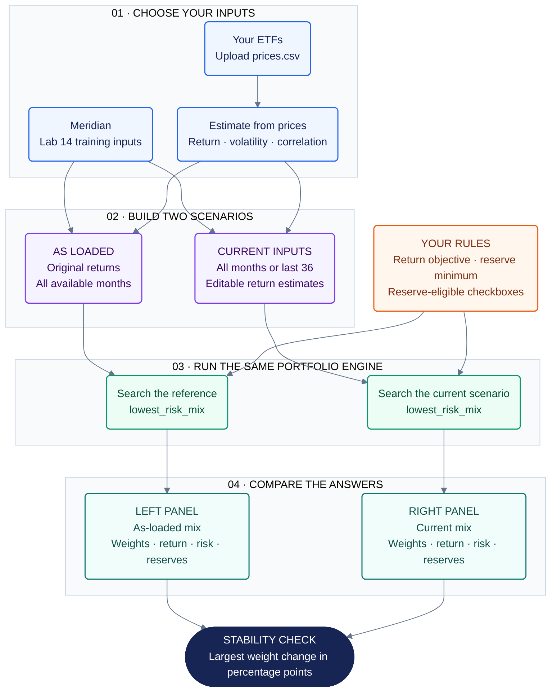
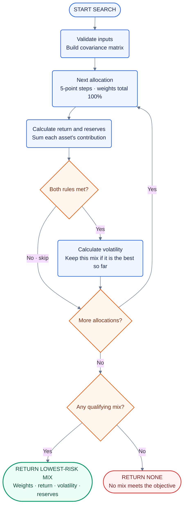

# Lab 15 · How My Portfolio App Works

**Decision:** Which mix carries the least risk while meeting the mandate—and does the answer survive a one-point change in one estimate?

The app follows two parallel paths: an **as-loaded reference** and a **current scenario**. Both use the same functions in `portfolio.py`. The colors below distinguish the stages; the numbered headings show the reading order.

## The app at a glance

**Read it aloud:** “I load either the training inputs or my ETF prices. The app creates a reference case and an editable case, applies the same rules to both, and uses my portfolio engine to find each lowest-risk mix. Then it shows how far the allocations moved.”

If a scenario has no qualifying allocation, its panel says **“no mix meets the objective.”** The weight-change metric appears only when both scenarios have a mix. The app does not lower the return objective to force an answer.

## Inside each search box

This is what `lowest_risk_mix()` actually does. The arrows returning to “Next allocation” are the loop: the code repeats those steps until it has checked every mix.

“Both rules” means **estimated portfolio return ≥ objective** and **reserve-eligible weight ≥ minimum**. Long-only weights and a total of 100% are built into the allocation generator. “Lowest risk” means the lowest calculated volatility among the qualifying mixes on this 5-point grid.

## How the chart aligns with my app

| Chart stage | What I see or change in the app | What the code does |
|---|---|---|
| **01 · Choose inputs** | Meridian opens by default. The sidebar has **Upload prices.csv**. | `app.py` uses `VEHICLES` and `CORRELATIONS` for Meridian or calls `estimate_from_csv()` for an upload. |
| **Estimate from prices** | The app shows the estimation period after upload. | `estimate_from_csv()` validates the file and calculates monthly returns as current price ÷ previous price − 1. Annual return estimate = monthly mean × 12; annual volatility = sample standard deviation × √12. It also calculates correlations. |
| **02 · As loaded** | The left answer is labeled **As loaded · Meridian** or **As loaded · all months**. | This path retains the original returns and full-window covariance. |
| **02 · Current inputs** | I can edit each **return estimate (%)** box and use **Use only the last 36 months**. | The current path uses the chosen window's volatility and correlations, plus my editable return estimates. The window switch applies only to uploaded data. |
| **Your rules** | Sidebar: **Return objective (%)**, **Reserve minimum (%)**. Main page: each asset's **reserve-eligible** checkbox. | The same current objective, reserve minimum, and eligibility choices go into both searches. Defaults are 6.5% and 3%; bills and the 10-year note count for Meridian. Uploaded funds start unchecked; the bundled My five ETFs choice starts with SGOV checked. |
| **03 · Portfolio engine** | The app updates when I change an input. | `app.py` calls `portfolio.lowest_risk_mix()` twice—once for each scenario. The engine reuses `expected_return()`, `covariance_matrix()`, and `portfolio_volatility()`. |
| **04 · Results** | Two panels show weights, return estimate, annualized volatility, and reserve weight to two decimals. | Each panel displays the result returned by its search, or the infeasible message if the result is `None`. |
| **Stability check** | **Largest weight change (percentage points)** below the panels. | `app.py` finds the largest absolute difference between corresponding weights and multiplies it by 100. |

Changing the estimation window or uploading a different dataset resets the return boxes to that dataset/window's estimates. Reserve selections persist when switching windows. Editing a return box alone leaves that window's volatility and correlations unchanged.

## Example: follow a change through the chart

Start with Meridian, a **6.5% objective**, and a **3% reserve minimum**. Change only the equity return estimate from **8.0% to 7.0%**.

| App result | As loaded: left panel | Current inputs: right panel |
|---|---:|---:|
| Treasury bills | 0% | 0% |
| 10-year Treasury note | 20% | 10% |
| Investment-grade bonds | 25% | 10% |
| Global equities | 55% | 80% |
| Return estimate | 6.51% | 6.53% |
| Volatility | 9.44% | 12.94% |
| Reserve-eligible weight | 20% | 10% |

The left branch keeps its original estimates. The right branch reruns the same search with the lower equity estimate. Its equity allocation moves from **55% to 80%**, so the app reports a **25-percentage-point** largest weight change.

The search shifts toward equities because it still has to meet the fixed return objective. Lowering an estimate can therefore make the chosen allocation riskier. That sensitivity is the question this lab asks us to investigate.

## My files and explanation

- App: [model/src/app.py](app.py)
- Portfolio engine: [model/src/portfolio.py](portfolio.py)
- ETF data: [prices.csv](prices.csv)
- Lab notes and data sources: [Lab15_summary.md](Lab15_Writeup.md)

> **What I can explain to my partner:** “The app is the control panel. My portfolio file does the calculations. Each search tests all allowed allocations, rejects those that miss the return or reserve requirement, and keeps the remaining mix with the lowest volatility. Comparing the two answers shows how sensitive that choice is to my estimates.”

Compare the search diagram with your required paper drawing. An unfamiliar box is a prompt to open that function and ask how it works. AI-generated diagrams do not replace the no-AI paper exercise or partner explanation.

**Viewing:** Open this file in GitHub's rendered view or a Markdown preview with Mermaid support. A plain-text editor shows the chart source instead of the diagram.
